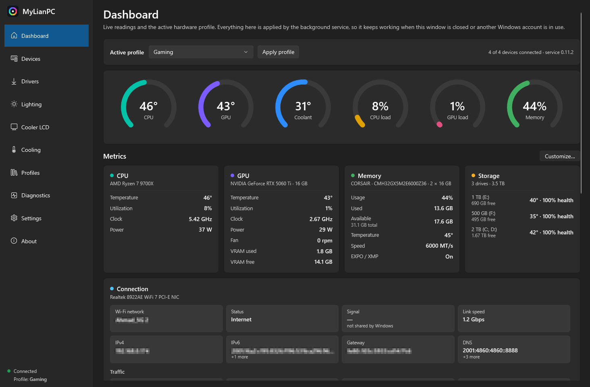
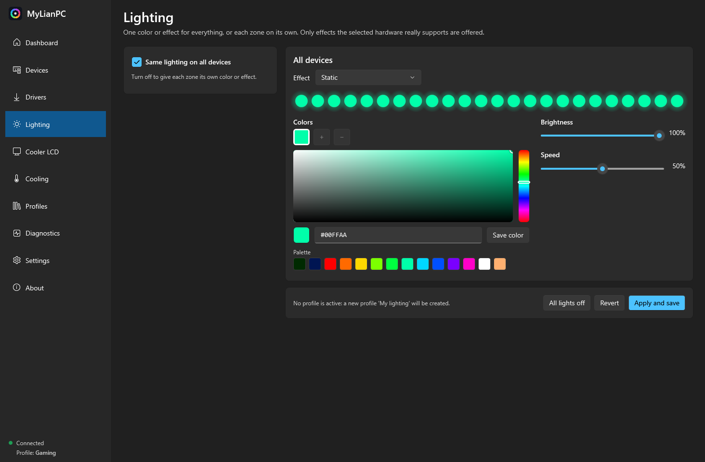
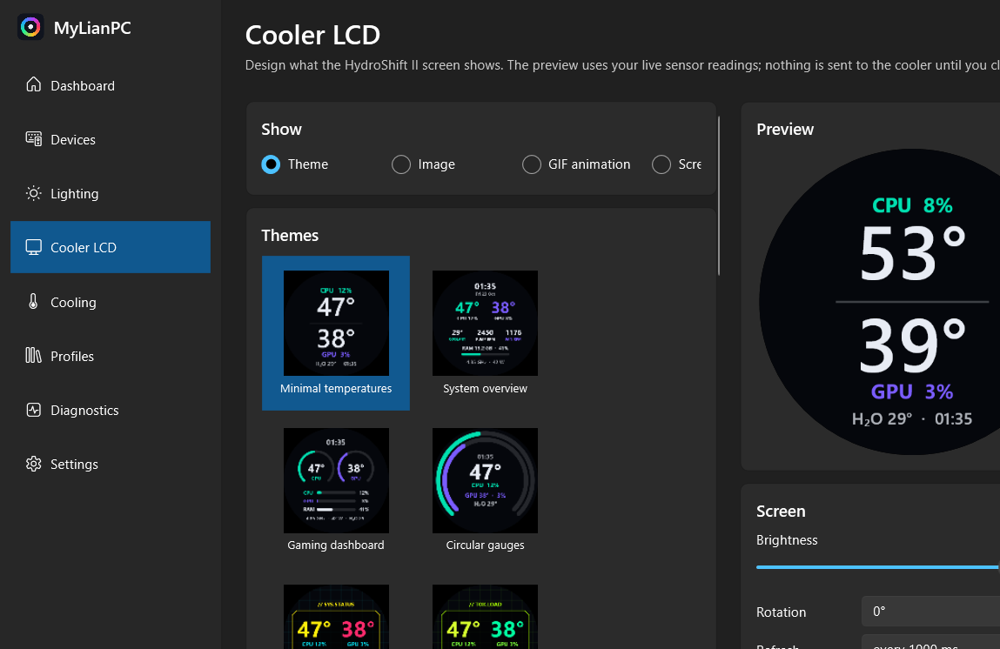
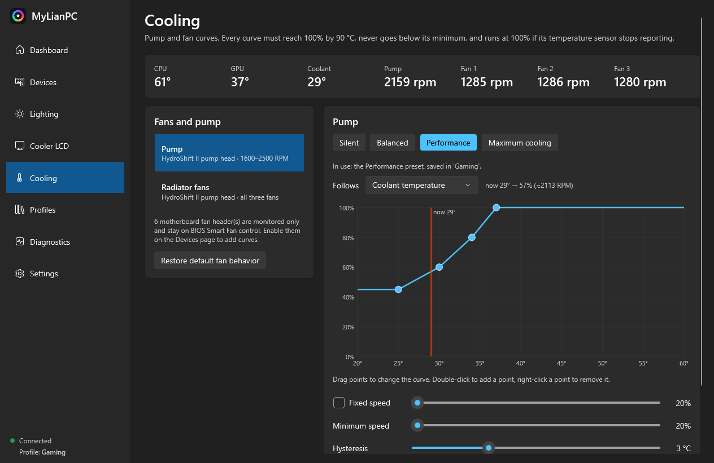

# MyLianPC

[](https://github.com/abdh01h/MyLianPC/releases)
[](#requirements)
[](#technology-stack)
[](LICENSE)

One Windows app for the **RGB lighting, cooler LCD, fan curves and hardware monitoring** of a PC built from
**GIGABYTE B850 AORUS ELITE WIFI7 + Lian Li HydroShift II LCD-C + Corsair Vengeance RGB DDR5 + Lian Li Vector V100R**,
replacing L-Connect 3, GIGABYTE Control Center and Corsair's service with a single background service and one window.

> ⚠️ **Beta 0.10** — feature complete for the hardware listed below, but still being tested. Expect rough edges, and
> expect every change to reach the hardware immediately (there is no simulation layer).

It talks to the hardware directly (USB HID, WinUSB and SMBus). Nothing is simulated: every control in the app maps to a
real command, and anything the hardware cannot do is not offered.

> Free and open source under GPL-2.0-or-later. Not affiliated with Lian Li, GIGABYTE or Corsair.

## Screenshots

| Dashboard — live readings | Lighting — one effect or per zone |
|---|---|
|  |  |
| **Cooler LCD — themes, gauges and image/GIF** | **Cooling — pump and radiator-fan curves** |
|  |  |

## What it is for

Vendor software for this build is split across three programs that each need their own background service, their own
account-level autostart and their own login. The result is duplicated hardware access, lighting that resets when you
switch Windows accounts, and three different places to set a fan curve.

MyLianPC replaces all three with:

* **one Windows service** that owns the hardware from boot, before anyone signs in, for every Windows account, and
* **one WPF window** that talks to that service over a local named pipe and needs no administrator rights.

If you close the window, sign out, switch accounts or lock the PC, lighting, the LCD and the fan curves keep running.

## Requirements

### Before you install

| Requirement | Details |
|---|---|
| **Windows** | Windows 11 (any edition) or Windows 10 version 2004 (build 19041) or newer, **64-bit (x64)** |
| **Administrator rights** | Needed **once**, by the installer: it registers the Windows service, installs the driver and takes over the vendor software. The app itself then runs as a normal user |
| **.NET runtime** | **Not required.** The installer ships a self-contained build of .NET 10 |
| **PawnIO driver** | Required for CPU temperature, motherboard fan headers and RAM lighting. The installer installs it with `winget`; if `winget`/App Installer is missing, install it once from [pawnio.eu](https://pawnio.eu) before or after setup. It is a signed kernel driver — Microsoft blocks the older WinRing0 driver, so this is the supported route |
| **Disk space** | About 150 MB for the program, plus profiles and logs in `C:\ProgramData\MyLianPC` |
| **Internet** | Only for the download, and for the one-time PawnIO install through `winget`. The app never phones home |
| **Vendor software** | L-Connect 3, GIGABYTE Control Center and Corsair Device Control Service must not run at the same time (WinUSB and SMBus are single-owner). The installer disables their autostart; nothing is uninstalled and **Settings → Vendor software → Restore** puts it back |
| **BIOS** | Nothing to change. The app never writes BIOS settings. Motherboard fan-header curves are opt-in (Devices page) |

### Supported hardware

Verified on the machine this was developed on. Other configurations in the same families are likely to work but are
untested — see [docs/COMPATIBILITY.md](docs/COMPATIBILITY.md) for the per-device truth table.

| Component | Device | Bus |
|---|---|---|
| Motherboard ARGB | GIGABYTE B850 AORUS ELITE WIFI7 (ITE IT5711, Fusion2 protocol) | USB HID |
| RAM RGB | Corsair Vengeance RGB DDR5 modules the Corsair DRAM protocol detects | SMBus via PawnIO |
| Cooler | Lian Li HydroShift II LCD-C (pump, 3 fans, 24-LED ring, LCD) | WinUSB |
| Motherboard fans | ITE IT8696E Super I/O headers (monitor always, control opt-in) | LPC via PawnIO |
| Monitoring | CPU (AMD Ryzen), GPU (NVAPI), memory, storage, coolant | LHM / NVAPI / WMI |

The case (Lian Li Vector V100R) has no USB device of its own: its strip is driven through a motherboard ARGB header and
its fans through motherboard PWM headers.

## Install

1. Download `MyLianPC-Setup-0.10.0-beta.exe` (or the zip) from the [releases](https://github.com/abdh01h/MyLianPC/releases).
2. Run it and approve the administrator prompt. Keep **Take over from vendor software** checked. This disables
   L-Connect 3's services, Corsair Device Control Service and GIGABYTE Control Center's sign-in task. Nothing is
   uninstalled, and **Settings → Vendor software → Restore** puts them back.
3. The installer also installs the **PawnIO** driver through winget if it is missing. It is needed for CPU temperatures,
   motherboard fan headers and RAM lighting.
4. **Shut the PC down once and switch the PSU off for ~15 seconds.** The cooler's controller only starts cleanly when
   no L-Connect video is still playing on it.
5. Open **MyLianPC** from the Start menu. In each Windows account, turn off Windows Dynamic Lighting for the motherboard
   once (Settings page). It is a per-account Windows setting.

Without the setup program, unpack the zip and run `install.ps1` from an elevated PowerShell. `uninstall.ps1` reverses it.

**Upgrading from the old name (MyPcRgb)?** The installer stops and removes the old `MyPcRgbService` and program folder,
and the first start copies your profiles, device settings and preferences from `C:\ProgramData\MyPcRgb` and
`%LOCALAPPDATA%\MyPcRgb` into the new folders. Nothing is lost; the old folder stays as a backup you can delete.

## Uninstall

Use *Apps & features → MyLianPC → Uninstall* (or `uninstall.ps1`). The service is removed and the vendor software is
restored to how it was before. Profiles in `C:\ProgramData\MyLianPC` are kept unless you delete the folder
(`uninstall.ps1` removes them unless you pass `-KeepData`).

## What it does

| Area | Features |
|---|---|
| Lighting | Motherboard ARGB headers (case strip and fans), chipset accent, LED_C, both RAM modules and the pump ring from one page. Same effect everywhere or per zone; static, breathing, flash, color cycle, rainbow, wave, gradient (per device where supported); hex input, palette and saved colors, brightness, speed |
| Cooler LCD | 20+ themes (minimal temps, system overview, gaming dashboard, circular gauges, cyberpunk, toxic HUD, synthwave HUD, ice HUD, ember HUD, dark neon, CPU & GPU monitor, image/GIF, minimal clock, analog clock, cooling focus, load bars, power draw, status list, diagonal split, multi-metric, custom layout with movable widgets); colors, fonts, text size, °C/°F, 12- or 24-hour clock, gauge style, metric selection, brightness, rotation, refresh rate, live preview |
| Cooling | Pump and radiator-fan curves following CPU, GPU or coolant temperature; Silent/Balanced/Performance/Maximum presets, fixed speed, minimum speed, hysteresis; the preset saved in the active profile is highlighted ("In use: the Silent preset, saved in 'Work'"); validated curves with a 100% failsafe; optional control of motherboard fan headers |
| Monitoring | CPU/GPU temperature, load, clock, power; memory usage, memory temperature, memory speed and whether EXPO/XMP is active; coolant; pump and fan RPM; storage health; gauges, one card per component with all of its readings, history charts |
| Profiles | Gaming, Work, Silent, Night Mode, Custom RGB, Maximum Cooling examples; create, rename, duplicate, delete, import, export, activate; per-device apply report. One shared list for the PC; each Windows account remembers the profile it last activated, and signing in applies it |
| Windows | Runs as a service from boot for **every Windows account**; re-asserts lighting after account switches; Dark, Light and System appearance (follows Windows live); tray icon; start with Windows can be turned on or off in the installer or in Settings (the service always starts either way) |

## Technology stack

| Layer | Technology |
|---|---|
| Language | C# 13 (`LangVersion=latest`), nullable reference types, file-scoped namespaces |
| Runtime | .NET 10 (`net10.0-windows10.0.19041.0`), published **self-contained** for `win-x64` |
| Desktop UI | WPF with the Fluent theme (`ThemeMode`, Dark/Light/System) and `CommunityToolkit.Mvvm`; no third-party UI kits |
| Background service | `Microsoft.Extensions.Hosting` + `Microsoft.Extensions.Hosting.WindowsServices` (generic host as a LocalSystem service) |
| Rendering | SkiaSharp for LCD themes, gauges, charts and the custom widget layout (rendered by the service, pushed to the panel as JPEG frames) |
| Hardware access | `HidSharp` (USB HID), hand-written WinUSB P/Invoke layer, `LibreHardwareMonitorLib` over PawnIO (SMBus, Super I/O), `System.Management`/WMI for storage and SMBIOS |
| IPC | Named pipe `\\.\pipe\MyLianPC`, JSON contract in `MyLianPC.Core.Ipc`, ACL limited to local interactive users and administrators |
| Persistence | JSON: `%ProgramData%\MyLianPC\profiles.json` (shared hardware profiles) and `%LOCALAPPDATA%\MyLianPC` (per-user UI preferences) |
| Installer | Inno Setup 6 (`installer/MyLianPC.iss`) plus PowerShell `install.ps1` / `uninstall.ps1` for the zip |
| Build | `dotnet` CLI driven by `build/publish.ps1`; the version lives in the application `.csproj` files |
| Tests | xUnit 2.9 on `Microsoft.NET.Test.Sdk` (`tests/MyLianPC.Core.Tests`) |

### Plugins (device adapters)

There is no runtime plugin loader — adapters are compiled in — but the hardware layer is plugin-shaped, so a new device
family is one class plus one registration:

```
src/MyLianPC.Hardware/
├─ Adapters/                          one adapter per device family, behind one common contract
│   ├─ Fusion2Adapter.cs              GIGABYTE motherboard ARGB (HID)
│   ├─ CorsairDramAdapter.cs          Corsair DDR5 modules (SMBus)
│   └─ HydroShiftAdapter.cs           Lian Li HydroShift II pump/fans/ring/LCD (WinUSB)
├─ Gigabyte/Fusion2Controller.cs      wire protocol, effect encoding, controller flash
├─ Corsair/CorsairDramController.cs   per-module LED frames over SMBus
├─ LianLi/HydroShift2Device.cs        WinUSB transport, JPEG frame push, telemetry
├─ LianLi/HydroShift2Protocol.cs      frame and command layout, checksums
├─ LianLi/TinyUz.cs                   firmware payload compression
├─ Smbus/PawnIoSmbus.cs, SmbusGate.cs driver bridge + shared-bus mutex
├─ Usb/WinUsbDevice.cs                WinUSB enumeration and transfers
└─ Sensors/SensorHub.cs               LibreHardwareMonitor + NVAPI + WMI aggregation
```

An adapter advertises what it can do (zones, effects, per-LED control, brightness, curves) and the UI only offers that.
A new device means implementing the adapter, registering it in `HardwareManager`, and it appears on **Devices**,
**Lighting** and **Cooling** automatically.

## Architecture

```
┌──────────────── session 0 (LocalSystem) ─────────────────┐      ┌── each user session ──┐
│ MyLianPC.Service (Windows service, single instance)        │      │ MyLianPC (WPF)          │
│  ├ DeviceManager → adapters (one owner per device)        │ pipe │  dashboard, RGB, LCD   │
│  │   HydroShift2 (WinUSB) · Fusion2 (HID) · CorsairDram   │◄────►│  editor, fan curves,   │
│  │   (SMBus/PawnIO) · SuperIO fans (LHM/PawnIO)           │ ACL: │  profiles, settings,   │
│  ├ SensorHub (LHM, 1 s default, cached snapshot)          │ Auth │  diagnostics           │
│  ├ CoolingController (validated curves, failsafe 100%)    │ Users│  theme: Dark/Light/Sys │
│  ├ LcdCompositor (SkiaSharp → JPEG, 1 fps metrics)        │      │  prefs: %LOCALAPPDATA% │
│  ├ ProfileStore  %ProgramData%\MyLianPC\profiles.json     │      └────────────────────────┘
│  └ Diagnostics/log  %ProgramData%\MyLianPC\logs           │
└───────────────────────────────────────────────────────────┘
```

* The service is the only process that touches hardware. It starts at boot, so lighting/LCD/cooling are applied before
  anyone logs in and are unaffected by logoff or account switching.
* Requests over the pipe are validated server-side; write operations need an elevated administrator.
* On service stop or crash: fans/pump are handed back to hardware/BIOS control (Super I/O restored to automatic; the
  pump head keeps its last safe duty), and lighting stays as last saved in controller memory.

## Build from source

Requirements: Windows 10/11 x64 and the **.NET 10 SDK**.

```powershell
dotnet test                                                   # unit tests
powershell -ExecutionPolicy Bypass -File build\publish.ps1    # artifacts\MyLianPC, zip, and setup .exe if Inno Setup 6 is installed
```

The publish script reads the version from `src/MyLianPC.App/MyLianPC.App.csproj` (`0.10.0-beta`), so bumping that one
property renames the zip and the setup executable.

| Project | Role |
|---|---|
| `src/MyLianPC.Core` | Profiles, validation, fan-curve logic, effects, settings, IPC contract and client |
| `src/MyLianPC.Hardware` | Device drivers (Fusion2 HID, Corsair DRAM over PawnIO SMBus, HydroShift II over WinUSB), sensor hub, adapters |
| `src/MyLianPC.Lcd` | LCD themes, image/GIF decoding, JPEG encoding (SkiaSharp) |
| `src/MyLianPC.Service` | Windows service: device ownership, cooling loop, LCD loop, session handling, named-pipe server, vendor takeover |
| `src/MyLianPC.App` | WPF desktop app (Fluent theme) |
| `tools/MyLianPC.Probe` | Hardware probe / test CLI used during development |
| `tests/MyLianPC.Core.Tests` | Unit tests (protocols, effects, curves, validation, persistence) |

The screenshots above are rendered by the app itself (`MyLianPC.exe --page <page> --screenshot <file.png>`), which is
also how visual regressions are checked in both themes.

## Documentation

* [docs/COMPATIBILITY.md](docs/COMPATIBILITY.md): hardware compatibility matrix, architecture, what is verified on real
  hardware and what still needs testing, and known limitations
* [docs/TROUBLESHOOTING.md](docs/TROUBLESHOOTING.md): problems, recovery procedure and safe defaults
* [THIRD-PARTY-NOTICES.md](THIRD-PARTY-NOTICES.md): licenses of ported code and dependencies

## Security and safety

* Hardware is touched only by the service (LocalSystem). The desktop app needs no administrator rights.
* The service's named pipe accepts only local interactive users, administrators and SYSTEM; network access is denied.
  Disabling or restoring vendor software needs an elevated administrator.
* Fan curves are validated (they must reach 100% by 90 °C, can't drop below their minimum, and the pump never goes
  below 1600 RPM). A missing sensor reading means 100%. The cooler's firmware falls back to its own curve about ten
  seconds after the last pump/fan command, so the commanded setpoint is repeated every five seconds. When the service
  stops, the pump and fans are set to a safe fixed speed and motherboard headers go back to BIOS control. BIOS settings
  are never changed.
* SMBus writes to the SPD address range (0x50-0x57) are refused in code; all SMBus traffic uses the shared system mutex.

## License

GPL-2.0-or-later. Portions are ported from OpenRGB (GPL-2.0-or-later); see [THIRD-PARTY-NOTICES.md](THIRD-PARTY-NOTICES.md).
